# AI Engineering Workflow

**How I use AI to investigate, implement, review, and verify software—while staying accountable for the result.**

I'm [Christian Mercado](https://github.com/mercadochristian), a software engineer documenting practices I've used and revised through real engineering work, including the times the workflow needed correcting.

My focus is engineering judgment: defining the right problem, giving AI useful boundaries, inspecting its output, and knowing what the evidence actually proves.



Small tasks stay direct. Larger tasks use bounded ownership and one current record. AI helps investigate, draft, test, and review; I own the decisions and authorization.

## Explore

| What to explore | Where to look |
| --- | --- |
| How I approach a task | [Engineering workflow](docs/workflow.md) |
| A verification mistake and the correction | [Checking the actual caller](case-studies/01-verification-boundaries.md) |
| A test failure after a permission change | [Making test preconditions explicit](case-studies/02-explicit-permissions.md) |
| Keeping work coherent across sessions | [Resuming from a verified checkpoint](case-studies/03-context-continuity.md) |
| A small example you can run | [Permission fixtures](examples/README.md) |
| Reusable skills for your own projects | [Shareable engineering skills](skills/README.md) |
| Investigating an unknown cause | [Issue investigation](docs/issue-investigation.md) |
| Evaluating a workflow change | [Skill evaluation](docs/skill-evaluation.md) |
| Transferring work between tools | [Cross-tool handoffs](docs/cross-tool-handoffs.md) |
| Measuring outcomes and effort | [Workflow measurement](docs/workflow-measurement.md) |
| What AI contributed here | [AI use and evidence](docs/ai-use-and-evidence.md) |

## What changed through practice

- **Verify a real caller early.** A successful isolated request can miss a failure in the actual page flow.
- **Make test setup explicit.** A success test must establish its required permissions rather than inherit them accidentally.
- **Keep one checkpoint per task.** Resume by checking current source and working-tree state, then update the same checkpoint.
- **Separate evidence boundaries.** A unit test, an HTTP response, a browser interaction, and a deployed integration prove different things.
- **Keep uncertainty visible.** A blocked integration remains blocked even when local checks pass.

The case studies explain these lessons without publishing private project details. They are retrospective accounts, not independently auditable production artifacts.

## Run the public example

Python 3.10 or newer is required. There are no third-party dependencies or external service calls.

```sh
python3 -B -m unittest discover -s tests -v
python3 -B scripts/check_docs.py
```

The example is original synthetic code illustrating a testing technique. It is not extracted from an employer's application. Passing it establishes the behavior of this example only. See [the example guide](examples/README.md) for its limits.

## Reuse the approach

- [Task brief](templates/task-brief.md): outcome, scope, ownership, and acceptance criteria.
- [Checkpoint](templates/checkpoint.md): current state, evidence, blockers, and next action.
- [Verification report](templates/verification-report.md): checked behavior and honest limits.
- [Investigation record](templates/investigation-record.md): observations, hypotheses, causal evidence, and remaining uncertainty.
- [Skill evaluation record](templates/skill-evaluation.md): comparable trials, observed behavior, and a bounded adoption decision.
- [Tool handoff](templates/tool-handoff.md): ownership, current state, and receiver checks.
- [Task outcome](templates/task-outcome.md): observed quality, effort, and comparison limits.
- [Coordination transition](templates/mode-transition.md): retain obligations when tools or coordination change.
- [Repository instructions](AGENTS.md): scoped guidance for AI work in this repository.

These are portable adaptations of practices I use, not an export of my private configuration. For a simple task, a short brief in the conversation may be enough.

The [skills guide](skills/README.md) covers project onboarding, behavior verification, QA planning, task context, and work updates, with example requests and installation guidance. These standalone instructions have been checked structurally; their behavior across different agents and projects remains unverified.

Optional guides cover [coordination](docs/execution-modes.md) and [scheduling when local performance is a constraint](docs/resource-aware-execution.md). These describe proposed procedures, not measured improvements or installed controls.

## What I'm still improving

I'm developing a habit of evaluating AI workflows through observable results. I do not have a controlled before/after study establishing productivity, token, or cost savings. I also don't treat a long instruction file or a model name as proof of engineering quality.

My [learning log](docs/learning-log.md) separates adopted practices from planned experiments. The [candidate skills](docs/skill-candidates.md) are future ideas, not implemented capabilities. This repository is a record of applied learning, not a claim to cover every new AI tool or research development.

## Privacy

Private work is described only at the level needed to explain an engineering lesson. Company and customer identities, application code, issue identifiers, internal URLs, credentials, and raw work logs are excluded. See [the publication boundary](docs/privacy.md).
