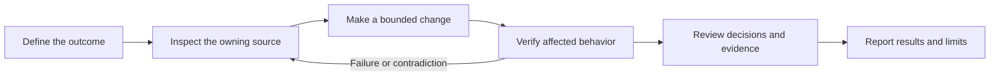

# AI Engineering Workflow

**How I use AI to investigate, implement, review, and verify software—while staying accountable for the result.**

I'm [Christian Mercado](https://github.com/mercadochristian), a software engineer building a practical approach to AI-assisted development. This repository documents practices I've used and revised through real engineering work, including the times the workflow needed correcting.

My focus is engineering judgment: defining the right problem, giving AI useful boundaries, inspecting its output, and knowing what the evidence actually proves.

## Start here

| What to explore | Where to look |
| --- | --- |
| How I approach a task | [Engineering workflow](docs/workflow.md) |
| A verification mistake and the correction | [Checking the actual caller](case-studies/01-verification-boundaries.md) |
| A test failure after a permission change | [Making test preconditions explicit](case-studies/02-explicit-permissions.md) |
| Keeping work coherent across sessions | [Resuming from a verified checkpoint](case-studies/03-context-continuity.md) |
| A small example you can run | [Permission fixtures](examples/README.md) |
| Reusable skills for your own projects | [Shareable engineering skills](skills/README.md) |
| What AI contributed here | [AI use and evidence](docs/ai-use-and-evidence.md) |

## The workflow



I handle small tasks directly. For work that benefits from another perspective, I give a specialist bounded ownership and keep consequential review independent of implementation. More agents are not an outcome.

AI helps with investigation, implementation drafts, test design, and review. I own the scope, permissions, design decisions, acceptance criteria, and decision to publish or deploy.

## What changed through practice

- **Verify a real caller early.** A successful isolated request can miss a failure in the actual page flow.
- **Make test setup explicit.** A success test must establish its required permissions rather than inherit them accidentally.
- **Keep one checkpoint per task.** Resume by checking current source and working-tree state, then update the same checkpoint.
- **Separate evidence boundaries.** A unit test, an HTTP response, a browser interaction, and a deployed integration prove different things.
- **Keep uncertainty visible.** A blocked integration remains blocked even when local checks pass.

The case studies explain these lessons without publishing private project details. They are retrospective accounts, not independently auditable production artifacts.

## Run the public example

Python 3.10 or newer is required. There are no third-party dependencies or external service calls.

```sh
python3 -B -m unittest discover -s tests -v
python3 -B scripts/check_docs.py
```

The example is original synthetic code illustrating a testing technique. It is not extracted from an employer's application. Passing it establishes the behavior of this example only. See [the example guide](examples/README.md) for its limits.

## Reuse the approach

- [Task brief](templates/task-brief.md): outcome, scope, ownership, and acceptance criteria.
- [Checkpoint](templates/checkpoint.md): current state, evidence, blockers, and next action.
- [Verification report](templates/verification-report.md): checked behavior and honest limits.
- [Repository instructions](AGENTS.md): scoped guidance for AI work in this repository.

These are portable adaptations of practices I use, not an export of my private configuration. For a simple task, a short brief in the conversation may be enough.

## Shareable skills

These three skills turn parts of the workflow into reusable instructions for a coding agent. Each stands on its own and can be adapted to different projects, stacks, and issue trackers.

| Skill | When to use it | What it produces |
| --- | --- | --- |
| [Project onboarding](skills/project-onboarding/SKILL.md) | Getting oriented in an unfamiliar repository or refreshing stale context | A source map, relevant development and verification commands, operational effects, and unknowns. |
| [Behavior verification](skills/behavior-verification/SKILL.md) | Verifying a completed change against its requirements | Results tied to the behavior checked, revision, target, and remaining gaps. |
| [QA test plan](skills/qa-test-plan/SKILL.md) | Planning manual checks from requirements and an actual diff | Observable scenarios with setup, numbered steps, expected results, and execution status. |

Copy the individual skill folder into the skill location supported by your coding agent, checking for an existing skill with the same name first. You can also read the Markdown and use the procedure directly. See the [usage guide](skills/README.md) for example requests and installation considerations.

The skills contain no private project configuration and require no other skill in this collection. Their structure and documentation have been checked locally; their behavior has not been validated across different coding agents or projects. The synthetic example's test results do not validate the skills.

## What I'm still improving

I'm developing a habit of evaluating AI workflows through observable results. I do not have a controlled before/after study establishing productivity, token, or cost savings. I also don't treat a long instruction file or a model name as proof of engineering quality.

My [learning log](docs/learning-log.md) separates adopted practices from planned experiments. This repository is a record of applied learning, not a claim to cover every new AI tool or research development.

## Privacy

Private work is described only at the level needed to explain an engineering lesson. Company and customer identities, application code, issue identifiers, internal URLs, credentials, and raw work logs are excluded. See [the publication boundary](docs/privacy.md).
